# ESTADIO OASIS + LA LÍNEA EN ANILLO — Centro de la Ciudad Ideal (v2)

Un estadio para **101,384 personas** dentro de un **anillo tipo "The Line"**: una plaza
comercial y de servicios con fachada de espejo, un cañón verde por dentro y un
**parque en la azotea**. Todo se genera con código para Blender.

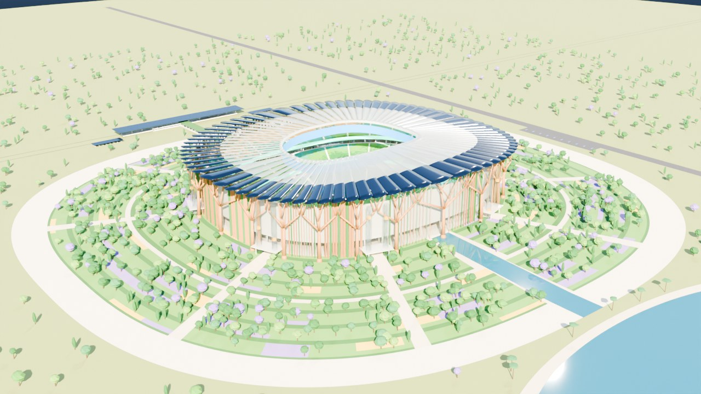

| | |
|---|---|
| 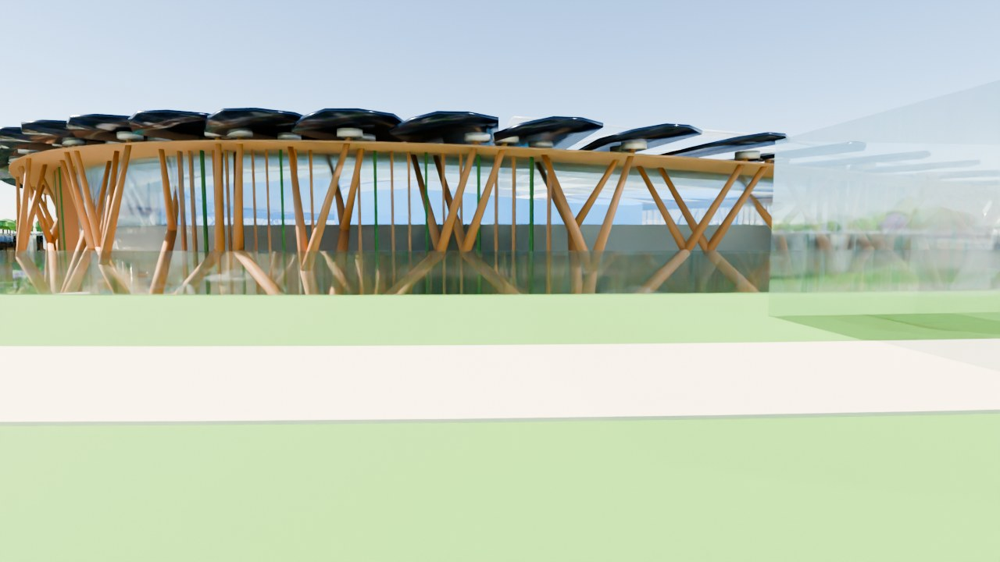 | 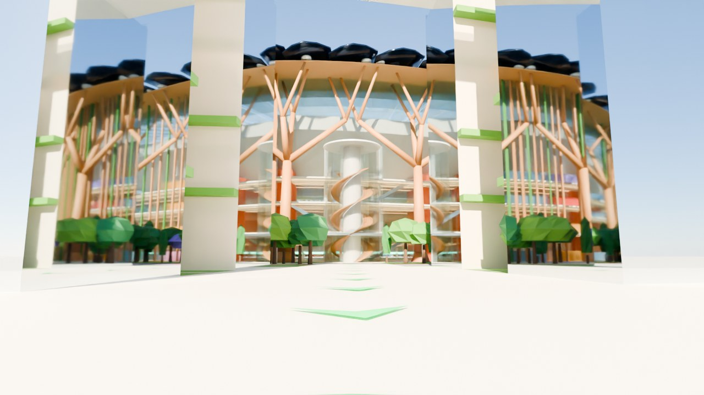 |
| 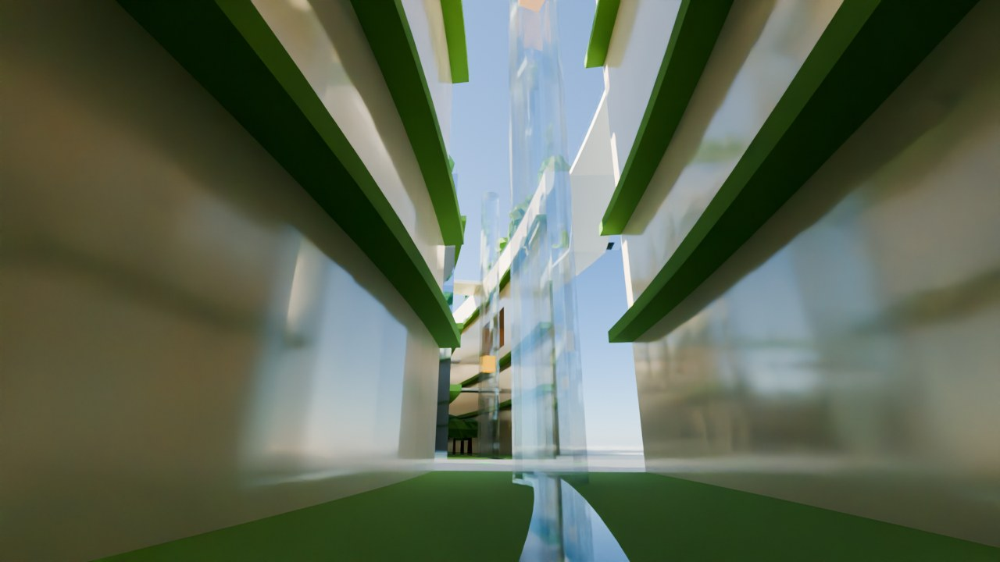 | 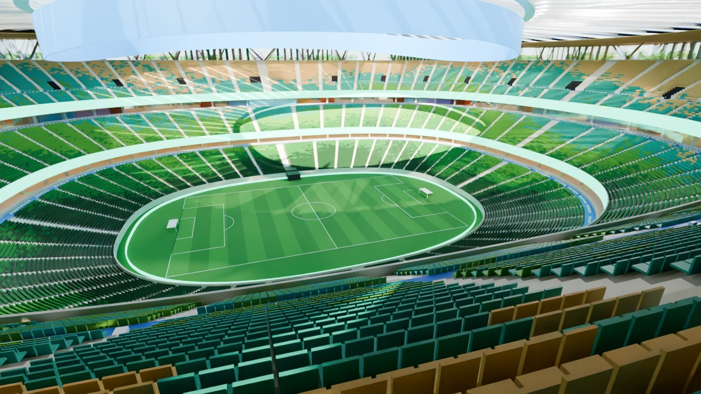 |
| 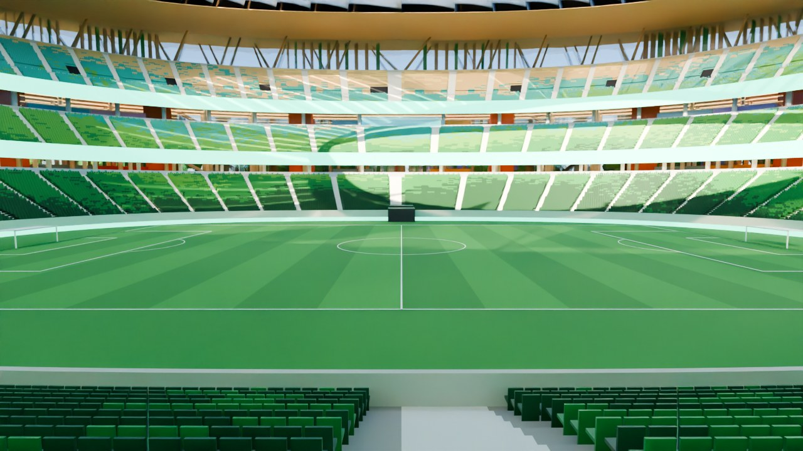 | 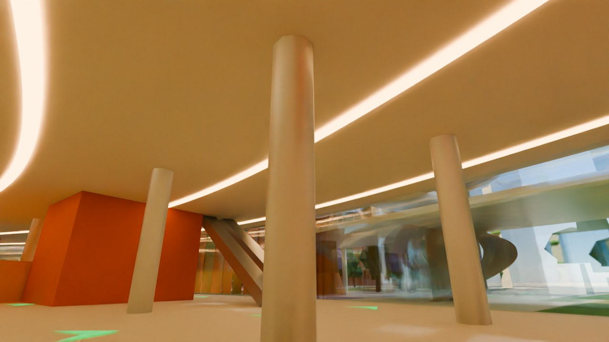 |
|  | 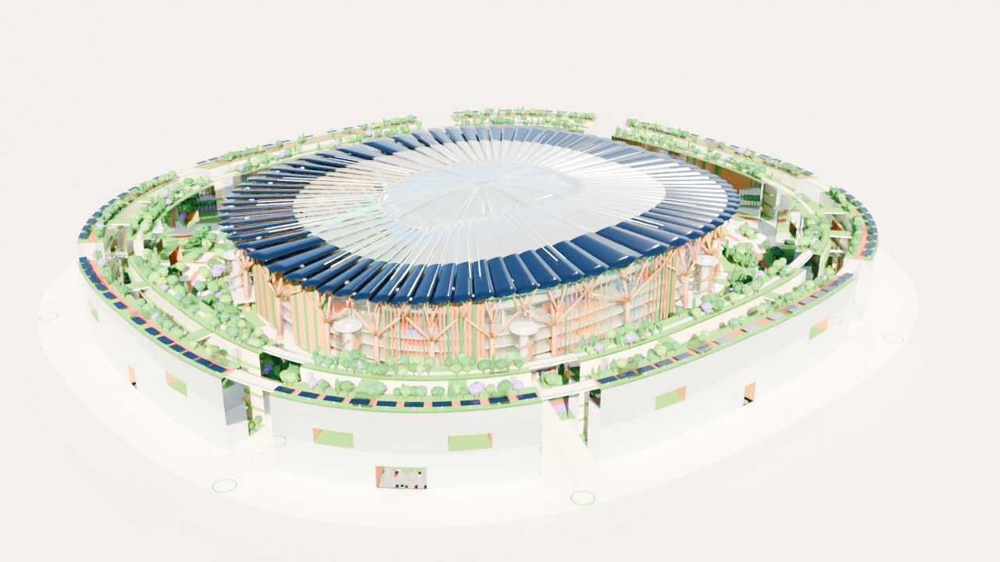 |
| 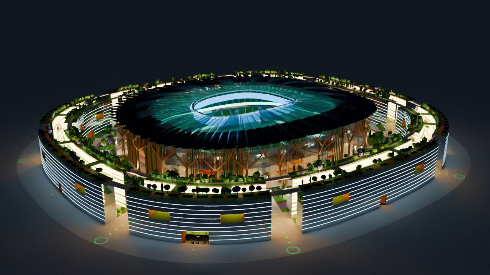 |  |
| 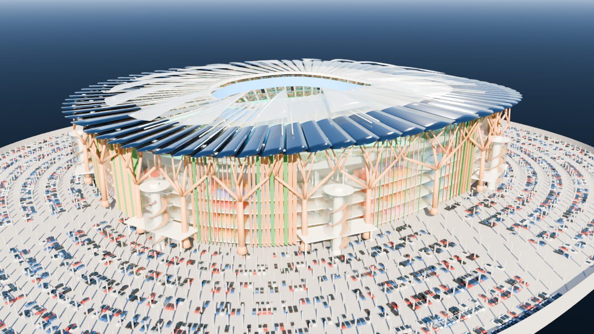 |  |
| 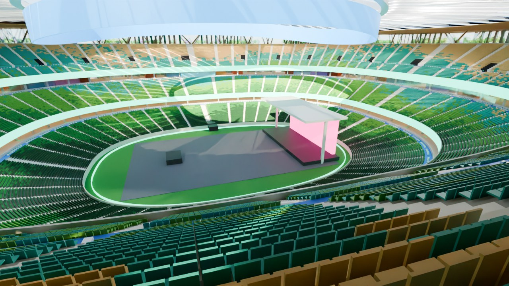 | 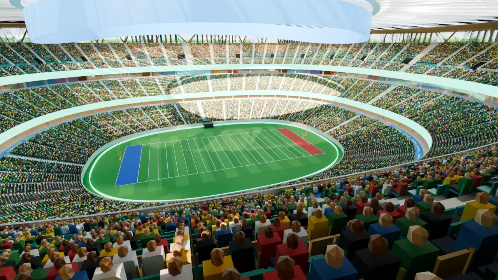 |

## Archivos

| Archivo | Qué es |
|---|---|
| `estadio_oasis.blend` | El modelo listo (Blender 4.2 o más nuevo). |
| `estadio_oasis.py` | El script que lo genera todo (modificable). |
| `previews/` | Renders de las cámaras incluidas. |

## Cómo usarlo en Blender

- **Día / Noche:** selector de **Escena** arriba a la derecha (`Dia` o `Noche`).
- **Techo retráctil:** mueve la línea de tiempo. **Frame 1 = abierto, frame 120 = cerrado**
  (barra espaciadora = reproducir). En la escena *Noche* empieza cerrado.
- **Otros deportes:** en el *Outliner*, prende/apaga las colecciones
  `02a_Modo_Futbol`, `02b_Modo_Futbol_Americano`, `02c_Modo_Rugby`,
  `02d_Modo_Concierto`, `02e_Modo_Arena_Central` (el ojito 👁 y la cámara 📷).
- **Ver lo subterráneo (estacionamiento, jugadores):** oculta `14_Plaza_Avenida_Suelo`,
  `13_Anillo_La_Linea` y `20_Ciudad`, y usa `CAM_Subterraneo_Rayos_X` o `CAM_Zona_Jugadores`.
- **Cámaras:** colección `21_Camaras` → selecciona una y **Ctrl + Numpad 0**.
- **Letreros explicativos:** colección `22_Etiquetas_Info` (salen en la vista 3D, no en el render).
- El modelo está optimizado: butacas, árboles y autos son **instancias** (un solo modelo repetido),
  así el archivo pesa ~5 MB. Si aun así la vista 3D va lenta, oculta `04_Butacas_Individuales`.

## Cómo se sube a los pisos del estadio (circulación vertical)

| Nivel | Altura | Qué hay | Cómo se llega |
|---|---|---|---|
| Campo / servicio | −12 m | cancha, jugadores, anillo de servicio | rampas de autobús, elevadores |
| **L0 Vestíbulo principal** | 0 m (= calle) | entrada, grada baja (se entra por arriba y se baja) | caminando, sin escalones |
| L0.5 Mezzanine | +9.5 m | comida, sanitarios, servicios | escaleras eléctricas, torres |
| L1 Vestíbulo medio | +19 m | grada media (se entra por arriba), palcos | escaleras eléctricas, torres |
| L2 Vestíbulo alto | +27 m | grada alta (24 vomitorios al pasillo transversal) | escaleras eléctricas, torres |

- **8 torres de circulación** (una en cada acceso): vidrio, **escalera de doble hélice**
  (dos escaleras de 3 m que no se cruzan, como en Chambord) + núcleo con **4 elevadores**
  (2 públicos, 1 de evacuación/bomberos, 1 de servicio) desde el estacionamiento hasta L2.
- **48 escaleras eléctricas** (L0 → L0.5 → L1 → L2, de subida y bajada en cada acceso).
- **16 núcleos de escape protegidos** (naranja) con escalera y elevador de evacuación.
- En total **48 elevadores** en el estadio.

## Normas de diseño revisadas por el script

El script calcula y revisa (la consola de Blender imprime todo: *Ventana > Alternar consola*):

| Criterio | Norma de referencia | Resultado |
|---|---|---|
| Visibilidad (C-value) | Green Guide (Reino Unido), FIFA: ≥ 60 mm, ideal 90 | **90 / 90 / 81 mm** |
| Pendiente de grada | Green Guide: ≤ 34° | **21° / 28° / 34°** |
| Butacas entre pasillos | Green Guide: ≤ 28 | **≤ 24** |
| Butaca / fila | ≥ 0.50 m / ≥ 0.80 m | **0.52 m / 0.85 m** |
| Asiento → vestíbulo | Green Guide: ≤ 8 min | **7.4 / 5.0 / 5.6 min** |
| Lugares silla de ruedas | ADA: 518 para este aforo | **1,021** (+ acompañante), en los 3 niveles |
| Sanitarios | ≈ 1 mueble por cada 40–60 personas | **≈ 2,400 muebles (1 por 42)** en 64 módulos |
| Rampas vehiculares | ≤ 15 % | **6.4 % autos, 9.7 % autobuses** |

Normas que un proyecto real en México debe cumplir (este modelo es conceptual):
Reglamento de Construcciones local y sus Normas Técnicas Complementarias (sismo,
viento, estructuras, proyecto arquitectónico), NOM-002-STPS (incendios),
NOM-003-SEGOB (señalización de protección civil), NOM-001-SEDE (instalaciones
eléctricas), NOM-081-SEMARNAT (ruido), NMX-R-050-SCFI (accesibilidad),
NOM-034-STPS (personas con discapacidad); y de referencia internacional:
NFPA 101 / 13 / 72 / 92, FIFA Stadium Guidelines, Green Guide (SGSA) y LEED / EDGE.
Se necesita un Director Responsable de Obra y corresponsables certificados.

## Evacuación

1. **Asiento → vestíbulo:** grada baja y media por sus pasillos radiales hacia arriba
   (el borde superior es todo salida); grada alta por **24 vomitorios** (93 m de ancho).
2. **Vestíbulos altos → calle:** 8 torres de doble hélice + 16 núcleos protegidos =
   **106 m de escaleras** (≈ 8.7 min para ~72,500 personas).
3. **Estadio → plaza interior:** 352 m de puertas en la fachada (≈ 2.6 min).
4. **Plaza interior → ciudad:** **8 brechas de 30 m + 8 portales de 24 m** (432 m, ≈ 2.2 min).
5. **Puntos de reunión** en el parque perimetral, frente a cada brecha (flechas verdes).

Además: carril de bomberos en la plaza interior (rojo), las brechas sirven de acceso a
camiones de bomberos, anillo de servicio a nivel de campo para ambulancias, centro de
mando y control (protección civil) en L1 norte, áreas de resguardo para personas en
silla de ruedas junto a cada elevador de evacuación, y el cañón del anillo es abierto
al cielo, así que el humo sale de forma natural.

## Servicios en los vestíbulos

128 módulos repartidos en los 4 niveles: **64 de sanitarios** (incluye familiares y de
género neutro, con cambiador para adultos), **37 de alimentos**, **9 de primeros auxilios**,
**9 salas sensoriales** (autismo / TDAH, con vista al campo) y **9 de lactancia y familia**,
más el **centro de mando y control** en L1 norte.

## Otros deportes y eventos

| Modo | Qué incluye | Cabe |
|---|---|---|
| Fútbol (activo) | cancha FIFA 105 × 68, porterías | 101,384 |
| Fútbol americano | 120 × 53.3 yd, zonas de anotación, postes amarillos | 101,384 |
| Rugby | 100 m + in-goal de 10 m, postes H | 101,384 |
| Concierto | escenario, pantalla, piso protector del pasto, mezcla (FOH), ~9,900 de pie en cancha a 2 personas/m² (se pierden ~10,000 butacas detrás del escenario) | ≈ 101,000 |
| Arena central | duela de básquet/box y gradas telescópicas a ras de campo (~3,400 más) | ≈ 104,800 |

Atletismo **no** cabe sin mover gradas (la pista de 400 m necesita 177 × 93 m); sería una
versión con gradas bajas retráctiles.

## Zona de jugadores (nivel de campo, lado norte)

Vestidores local y visitante, vestidores de árbitros y árbitras, enfermería, antidopaje,
fisioterapia/hidroterapia, utilería, sala de calentamiento con pista de 60 m, zona mixta,
sala de prensa (250), sala de niños escolta y familias, túnel de jugadores bajo la grada
con manga telescópica, y llegada de autobuses por el anillo de servicio subterráneo.

## Techo retráctil y aislamiento acústico

- **16 hojas de ETFE** que se deslizan sobre rieles (≈ 15–20 min para cerrar).
- **Plafón acústico de madera** bajo toda la zona solar de la cubierta.
- **Fachada de doble piel** de vidrio acústico.
- Las ventilas entre hojas llevan **silenciadores tipo bafle**.
- **El anillo funciona como barrera de sonido:** por eso es plaza (comercio, oficinas,
  servicios) y no vivienda. Sus caras hacia el estadio llevan vidrio acústico laminado.
- La **cascada** enmascara el ruido en la plaza interior.
- Meta de diseño: **≤ 60 dB(A) en la fachada exterior del anillo** durante un concierto
  (la NOM-081 permite 68 dB(A) de día y 65 de noche en el límite del predio) y
  horario de conciertos hasta las 23:00 con limitador de sonido.
- Honestidad técnica: el ETFE solo aísla poco; el aislamiento real viene de la
  combinación de todas las capas anteriores.

## La Línea en anillo (plaza)

| | |
|---|---|
| Ancho | 46 m: torre interior 16 m + **cañón verde 14 m** + torre exterior 16 m |
| Altura | 45 m (10 niveles) + parque en la azotea |
| Superficie construida | **≈ 386,000 m²** |
| Tramos | 8, separados por brechas de 30 m (son también juntas sísmicas) |
| Conexiones con la ciudad | 8 brechas + 8 portales de 24 m + 16 ventanas urbanas + puentes en la azotea |
| Circulación vertical | **42 núcleos** (escalera protegida + elevadores) cada ~60 m, elevadores panorámicos y escaleras eléctricas en el cañón |
| Parque en la azotea | ≈ 4.3 ha, pista de trote continua de ~1.5 km, pérgolas solares, barandal de vidrio de 1.2 m |

Programa sugerido: tiendas y restaurantes (niveles 0–3), cines, museo del deporte,
gimnasio y centro deportivo, clínica, guardería, coworking y oficinas, hotel para
aficionados y equipos, y la tienda oficial / taquillas del estadio.

## Estacionamiento y movilidad

- **P1 (−6 m): 5,688 cajones** (3 % accesibles = 171; 30 % con cargador eléctrico).
- **P2 (−12 m):** autobuses de equipos y lanzaderas accesibles, logística, bicicletas,
  centro de energía (baterías) y **cisternas de agua de lluvia (≈ 7,700 m³)**.
- **Tranvía en anillo** con 2 estaciones, **metro subterráneo**, 4 paradas de autobús
  eléctrico, ciclovía y cruces peatonales elevados.
- Durante eventos la avenida se cierra a autos y queda como zona peatonal de salida.

## Consumo aproximado (estimaciones de concepto)

| | Estadio | La Línea (plaza) |
|---|---|---|
| **Electricidad** | **≈ 8.7 GWh/año** (60 eventos ≈ 50 MWh c/u + operación diaria) | **≈ 44 GWh/año** (115 kWh/m²·año) + estacionamiento ≈ 3.8 |
| Pico de potencia | ≈ 8–10 MW en partido | ≈ 10 MW |
| Solar en sitio | **≈ 16 GWh/año** (10.1 MWp en la cubierta) → **produce más de lo que gasta** | ≈ 4 GWh/año (pérgolas + fachada fotovoltaica) → ~9 % |
| **Agua** | **≈ 94,000 m³/año** | **≈ 212,000 m³/año** + riego ≈ 33,000 |
| Lluvia captada | ≈ 55,000 m³/año para riego, sanitarios y la cascada | (incluida) |

Para que el conjunto sea neto cero, el excedente solar del estadio (~7.5 GWh) se
manda al anillo y el resto se compra a parques solares/eólicos (contrato PPA).

Supuestos (ajustables al inicio del script): 60 eventos al año, 0.21 kWp/m² de
panel, 1,600 kWh/kWp·año en cubierta, 650 en fachada, 700 mm de lluvia al año.

## Sustentabilidad del anillo

Ventilación natural por el cañón, sombra propia, luz natural profunda (16 m de
ancho por torre), fachada exterior fotovoltaica, techo verde de 4.3 ha (aísla
y enfría), agua de lluvia y gris reciclada, geotermia/district cooling compartido
con el estadio, madera laminada donde se pueda, vegetación nativa, y una ubicación
céntrica con tranvía, metro y bici.

Es un modelo conceptual / de volumetría, no un proyecto ejecutivo.
