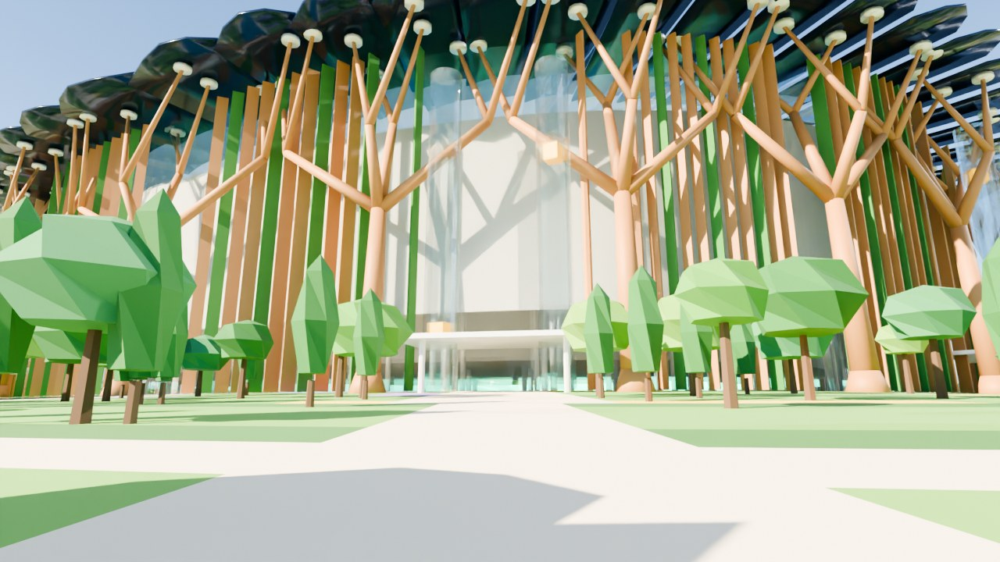
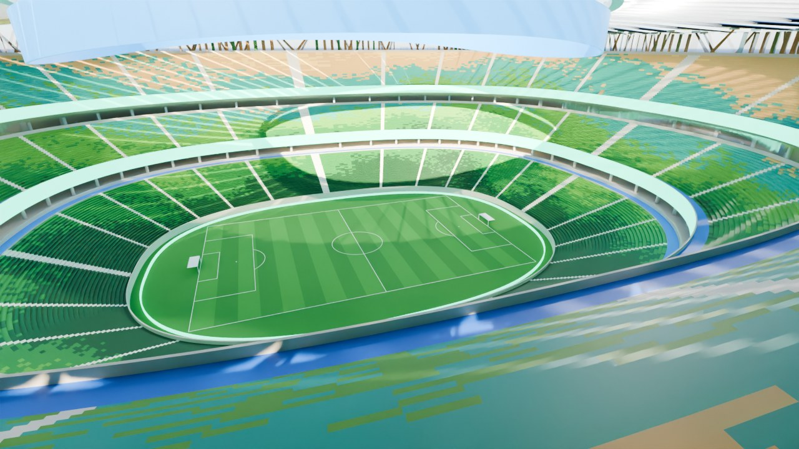
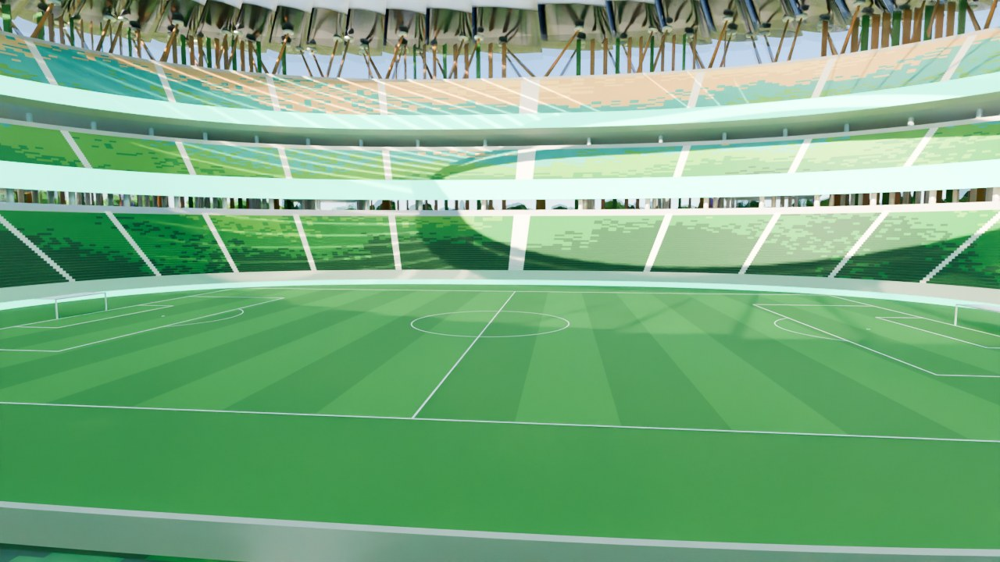
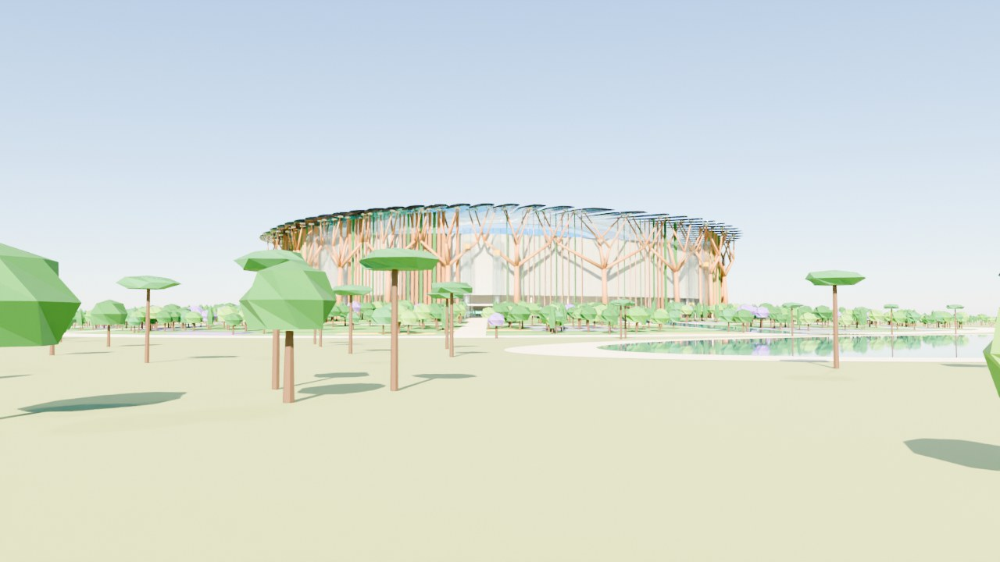

# ESTADIO OASIS — Ciudad Ideal

Estadio para **102,112 personas** que brota de una colina-parque, combinando
tecnología, diseño y naturaleza. Hecho 100 % con código para Blender.

| | |
|---|---|
|  |  |
|  |  |

## Contenido de la carpeta

| Archivo | Qué es |
|---|---|
| `estadio_oasis.blend` | El modelo listo para abrir en Blender (4.2 o más nuevo). |
| `estadio_oasis.py` | El script que genera todo desde cero (lo puedes modificar). |
| `previews/` | Renders de las 6 cámaras incluidas. |

## Cómo abrirlo

**Opción fácil:** doble clic en `estadio_oasis.blend`.

**Opción script (para modificarlo):**
1. Blender → *Archivo > Nuevo > General*.
2. Pestaña **Scripting** → **Abrir** → `estadio_oasis.py` → **Ejecutar script ▶**.
3. ⚠️ El script borra lo que haya en la escena antes de construir.

Tips dentro de Blender:
- Pulsa **Z → Vista de material** (Material Preview) para ver los colores, o **F12** para renderizar.
- Cámaras incluidas (colección `10_Camaras`): `CAM_Aerea`, `CAM_Llegada_Peaton`,
  `CAM_Interior_Grada`, `CAM_Grada_Baja`, `CAM_Lago_Atardecer`, `CAM_Estacion`.
  Selecciona una y pulsa **Ctrl + Numpad 0** para verla.
- La colección `11_Etiquetas_Info` tiene letreros que explican cada parte
  (salen en la vista 3D, no en el render). Ocúltala con el ojito si estorba.
- Para renders realistas cambia el motor a **Cycles** en *Propiedades de render*.

## La referencia de Arabia Saudita

El que combina naturaleza y estadio es el **Estadio Príncipe Mohammed bin Salman**
en **Qiddiya** (cerca de Riad, sede del Mundial 2034): está construido al borde del
acantilado de Tuwaiq, como si saliera de la roca. También está el
**Estadio Internacional Rey Salman** (Riad, ~92,000 lugares), rodeado por el parque
King Salman. Este proyecto toma esa idea —**el estadio como parte del paisaje**— y la
lleva a una ciudad ideal: en vez de acantilado, una **colina habitada**.

## Concepto

1. **Campo hundido 8 m** → el edificio se ve menos masivo y el subsuelo lo mantiene fresco.
2. **Colina-parque** que sube al **4.7 %** hasta el vestíbulo principal: cualquier persona
   (silla de ruedas, carriola, adulto mayor) entra **sin una sola escalera**. Es un parque
   público abierto los 365 días, con terrazas, flores, 1,400 árboles y senderos.
3. **Árboles estructurales** (24) de madera laminada y acero que se ramifican para
   sostener la cubierta.
4. **Cubierta de hojas**: 72 hojas traslapadas como tejas. La parte interior es **ETFE
   translúcido** (luz natural para el pasto) y la exterior son **paneles solares**
   (~37,000 m² ≈ **7.8 MWp**). El borde levantado de cada hoja deja salir el aire
   caliente → **ventilación natural**.
5. **Fachada** de vidrio con **320 aletas paramétricas** que giran en ola y cada tercera
   es un **jardín vertical**.
6. **Agua**: la lluvia de la cubierta baja por un **canal-cascada** hasta un **lago de
   enfriamiento y retención**.
7. **Gradas con degradado** bosque → oasis → desierto/sol (verde abajo, arena y oro arriba).
8. **Halo LED 360°** colgado del anillo de compresión: todos ven la repetición, sin
   importar su asiento.

## Números

| Concepto | Valor |
|---|---|
| Butacas (3 niveles) | 99,908 |
| Lugares para silla de ruedas | 1,102 + 1,102 acompañantes (≈ 2× lo que pide la norma ADA) |
| **Aforo total** | **102,112** |
| Campo | 105 × 68 m, hundido 8 m |
| Huella con colina y plaza | ~ 665 × 625 m |
| Altura sobre la plaza | ~ 70 m |
| Cubierta ETFE / solar | ~ 39,000 m² / ~ 37,000 m² |
| Elevadores panorámicos | 16 (2 en cada uno de los 8 accesos) |

Las cifras las calcula el script al correr (consola de Blender: *Ventana > Alternar consola*).

## Inclusión y accesibilidad (lo que ya está modelado ✅ y lo que el programa debe incluir)

- ✅ Acceso **universal sin escaleras** (colina al 4.7 %, menor al 5 % que marcan las normas).
- ✅ **Plataformas para silla de ruedas en los 3 niveles** (azules), con lugar para acompañante,
  En las gradas media y alta están al frente, sin nadie que tape la vista.
- ✅ **16 elevadores** panorámicos + 8 accesos a nivel con marquesina.
- ✅ **Estación de tren ligero a nivel**, pasarela techada con pérgola hasta la plaza.
- ✅ **Bus eléctrico** y zona de **ascenso/descenso accesible** con cajones azules.
- ✅ **Bicipuertos** techados con paneles solares.
- ✅ **Túnel de emergencias** a nivel de campo y vestíbulo abierto con vista al campo.
- Salas sensoriales (autismo / TDAH) con vista al partido y aislamiento acústico.
- Baños familiares y de género neutro, cambiadores para adultos, salas de lactancia.
- Guías podotáctiles, señalética en braille, alto contraste y pictogramas.
- Aro magnético para auxiliares auditivos, audiodescripción y **lengua de señas** en el halo.
- Butacas más anchas para personas de talla grande y asientos con descansabrazos abatibles.
- Zonas de descanso para perros de asistencia, bebederos gratuitos, sombra en todo el recorrido.
- Puestos médicos en cada nivel, cuartos de oración/meditación, cuartos de calma.
- Evacuación en < 8 min: 24 pasillos por grada, 8 accesos y la colina como zona segura.

## Sustentabilidad

- Energía solar en cubierta y estacionamientos de bicicletas; meta de energía neta cero.
- Agua de lluvia reciclada para riego, sanitarios y el lago de enfriamiento.
- Madera laminada (captura de carbono) en árboles estructurales y aletas.
- Vegetación nativa resistente a la sequía; pavimentos permeables.
- Ciudad con poco auto: tren, bus eléctrico y bici como acceso principal.
- Uso diario: parque, pista para correr, mercados y cine al aire libre en la colina.

## Modificar el diseño

Todo está en la sección `PARÁMETROS` al inicio de `estadio_oasis.py`:
- `TIERS`: filas, alturas y pendiente de cada grada (cambia el aforo).
- `NEXP`: forma del estadio (2 = óvalo, 3+ = más cuadrado).
- `ROOF_IN` / `ROOF_OUT` y la función `z_roof()`: forma de la cubierta.
- `N_TREES`, `ENTRIES`, `BERM_END`: árboles estructurales, accesos y tamaño de la colina.

Es un modelo conceptual / de volumetría, no un proyecto ejecutivo.
