# ESTADIO YAXCHÉ + PLAZA SAKBÉ — Centro de la Ciudad Ideal (v3)

> **Yaxché** es la ceiba sagrada maya: sus raíces, su tronco y su copa unen el inframundo,
> la tierra y el cielo, igual que el estadio une el campo hundido, los vestíbulos y la cubierta
> de hojas sostenida por árboles. **Sakbé** significa "camino blanco": es el anillo-plaza que
> rodea al estadio, con un parque elevado en la azotea.

Solo se modelan el estadio, la plaza en anillo y una explanada alrededor. La ciudad no se incluye.

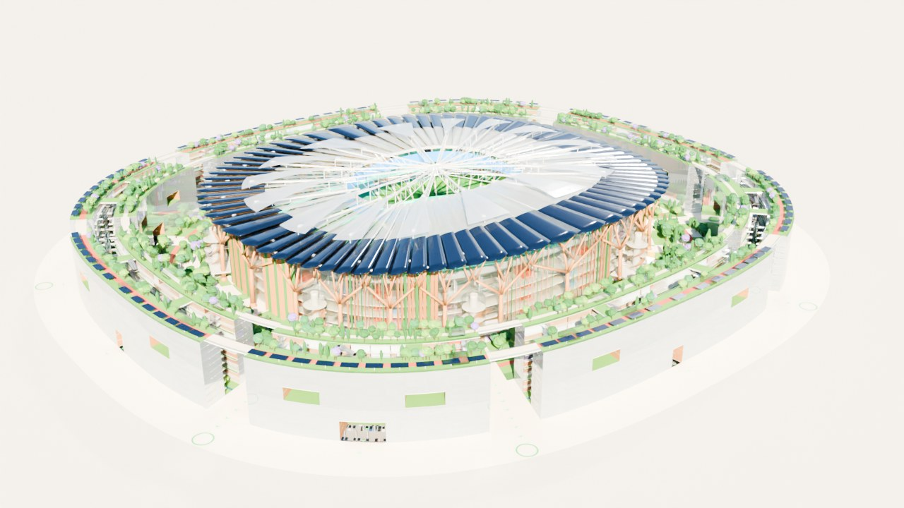

| | |
|---|---|
| 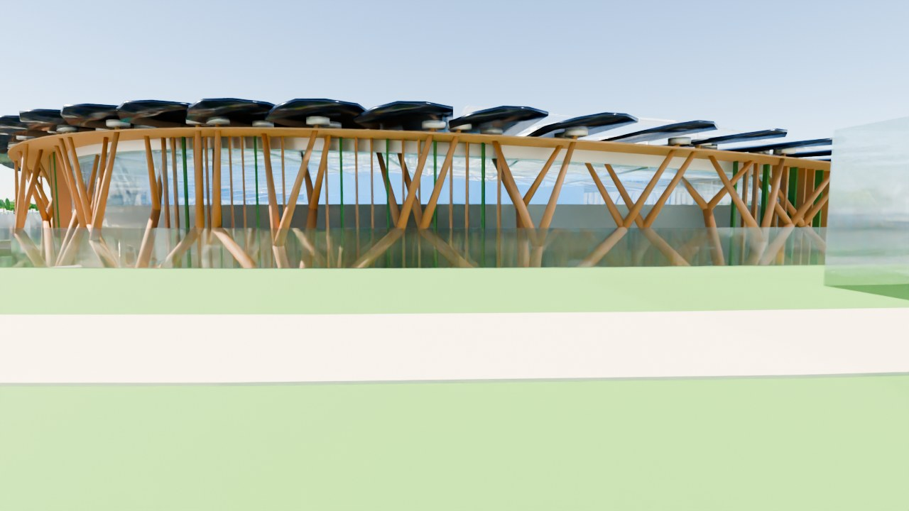 | 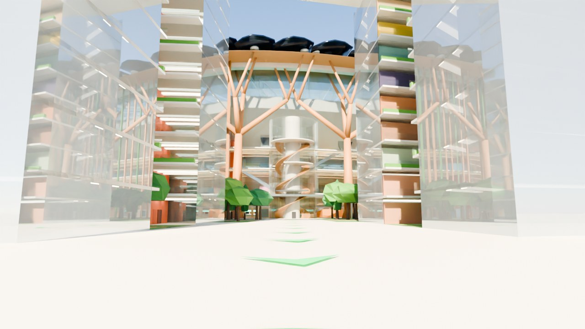 |
|  | 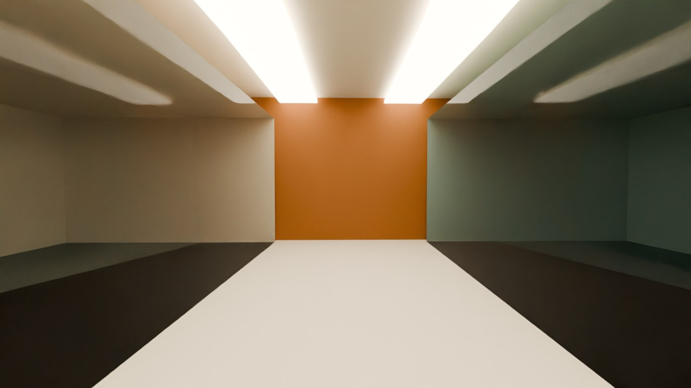 |
| 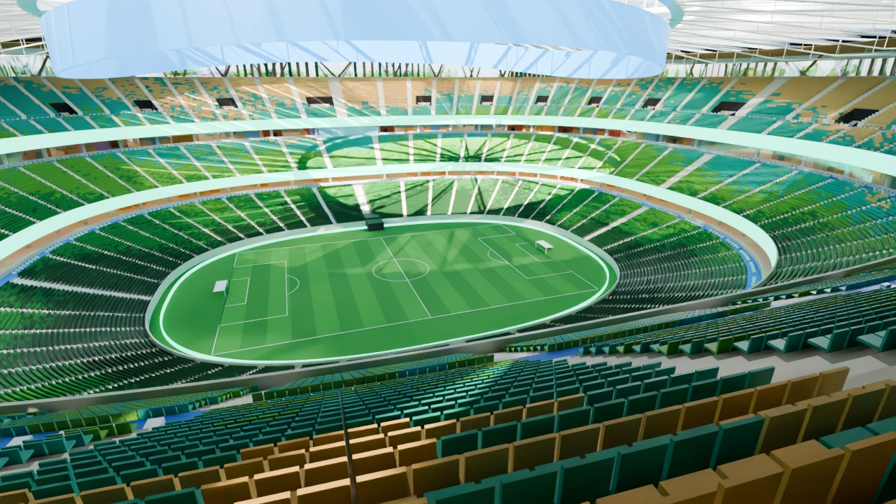 |  |
| 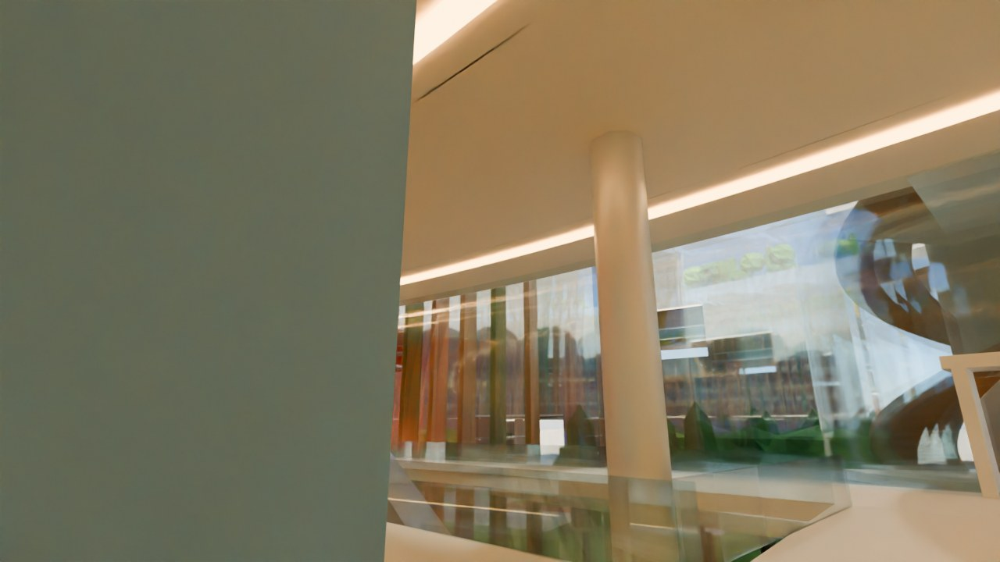 | 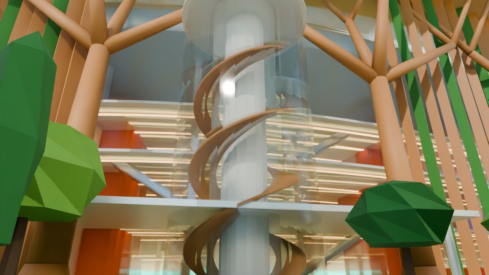 |
| 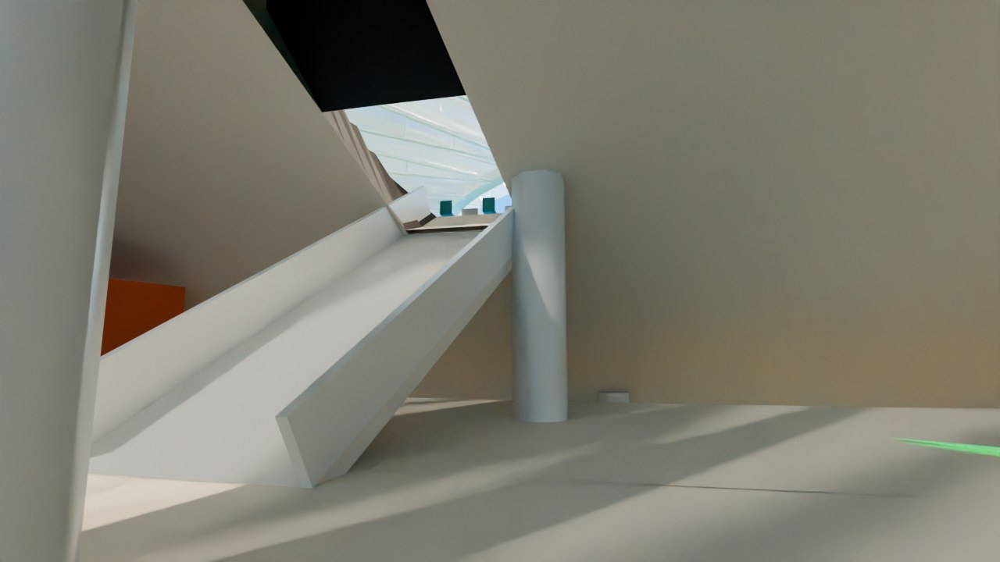 | 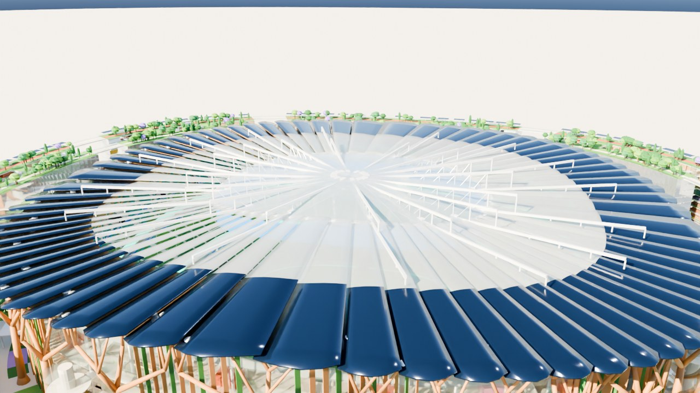 |
|  |  |
| 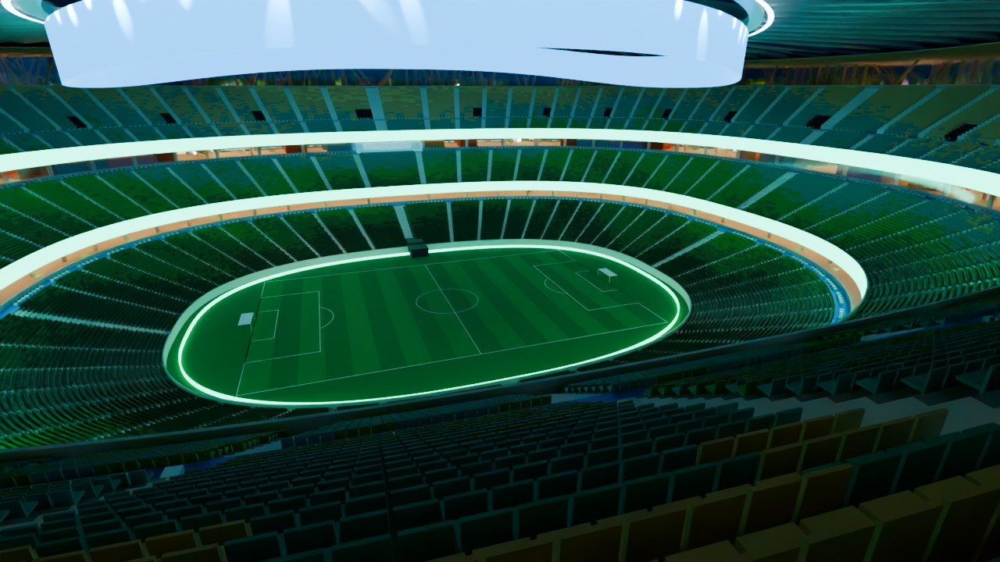 | 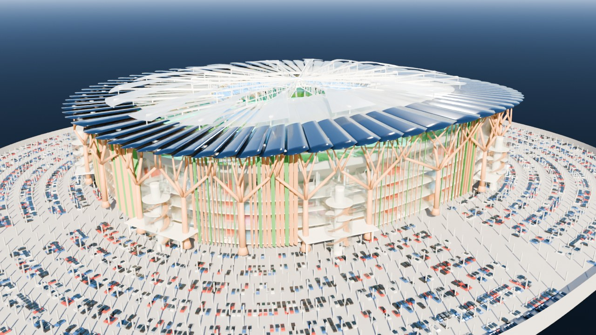 |
| 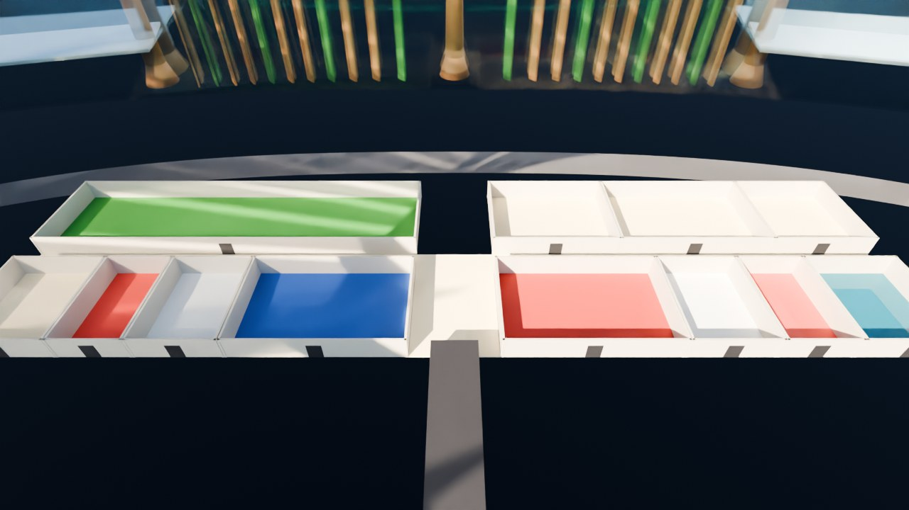 | 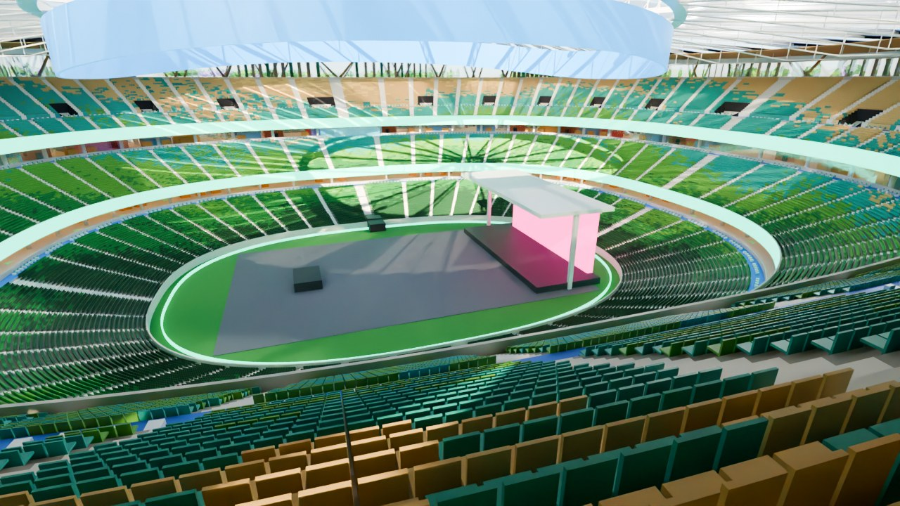 |

## Archivos

| Archivo | Qué es |
|---|---|
| `estadio_yaxche.blend` | El modelo listo (Blender 4.2 o más nuevo). |
| `estadio_yaxche.py` | El script que lo genera todo (modificable). |
| `previews/` | Renders de las cámaras incluidas. |

## Medidas (largo × ancho)

| Zona | Largo × ancho |
|---|---|
| Cancha | 105 × 68 m |
| Estadio (fachada de vidrio) | 322 × 281 m |
| Estadio con la cubierta | 361 × 320 m |
| Plaza Sakbé (borde exterior del anillo) | 537 × 496 m |
| **Todo, con la explanada exterior** | **597 × 556 m (≈ 28.4 ha)** |

## Cómo usarlo en Blender

- **Día / Noche:** selector de **Escena** arriba a la derecha (`Dia` o `Noche`).
- **Techo retráctil:** mueve la línea de tiempo. **Frame 1 = abierto, frame 120 = cerrado.**
- **Otros deportes:** prende/apaga las colecciones `02a` a `02e` en el *Outliner*.
- **Ver lo subterráneo:** oculta `14_Plaza_Avenida_Suelo` y `13_Plaza_Sakbe`; usa
  `CAM_Subterraneo_Rayos_X` o `CAM_Zona_Jugadores`.
- **Cámaras:** colección `19_Camaras` → selecciona una y **Ctrl + Numpad 0**.
- **Letreros explicativos:** colección `20_Etiquetas_Info` (salen en la vista 3D, no en el render).
- Butacas, árboles y autos son **instancias**. Si la vista 3D va lenta, oculta `04_Butacas_Individuales`.

## Cómo se sube a cada piso del estadio

| Nivel | Altura | Qué hay | Cómo se llega |
|---|---|---|---|
| Campo / servicio | −12 m | cancha, jugadores, anillo de servicio | elevadores de las torres y núcleos |
| **L0 Vestíbulo principal** | 0 m (= calle) | grada baja: se entra por arriba y se baja | caminando, sin escalones |
| L0.5 Mezzanine | +9.5 m | sanitarios, comida, servicios | escaleras eléctricas, torres |
| L1 Vestíbulo medio | +19 m | grada media: se entra por arriba; palcos | escaleras eléctricas, torres |
| L2 Vestíbulo alto | +27 m | grada alta por **24 vomitorios** | escaleras eléctricas, torres |

- **Escaleras eléctricas** L0 → L0.5 → L1 → L2 en cada acceso, con **huecos en las losas** y
  barandal de vidrio (48 en total).
- **8 torres de vidrio** con **escalera de doble hélice** (dos escaleras de 3 m que no se
  cruzan) y **descansos en cada nivel**. Los descansos tienen hueco donde pasa la hélice y
  **puente + puerta** a cada vestíbulo. Núcleo con 4 elevadores desde el estacionamiento.
- **Vomitorios de la grada alta:** desde el pasillo transversal (con lugares para silla de
  ruedas), una escalera baja por la zanja, atraviesa la losa y llega al vestíbulo L2.
- **16 núcleos de escape protegidos** (naranja) con **puerta cortafuego en cada nivel**.
- La **fachada tiene puertas reales**: 16 puertas principales de 16 m, 16 salidas de
  emergencia y puertas en cada puente de las torres.

## El techo retráctil: qué lo sostiene

1. La **cubierta fija** (hojas de ETFE y paneles solares) cuelga de **36 armaduras radiales**
   entre un **anillo de compresión exterior**, apoyado en los 24 árboles estructurales, y un
   **anillo de tensión interior**. Es el principio de una rueda de bicicleta.
2. Las **16 hojas móviles** tienen cada una **2 carritos** que ruedan sobre **2 vigas-riel**
   de acero.
3. Las vigas-riel interiores parten de un **cubo central** (anillo de acero en el centro) y
   llevan **armadura inferior**. Sobre la cubierta fija se apoyan en **postes cada ~12 m**.
4. Al abrir, cada hoja sube 3 m y se desliza en línea recta hasta quedar estacionada sobre
   la cubierta fija. Al cerrar, regresa y se apoya en el cubo central (≈ 15–20 min).

## Plaza Sakbé (anillo estilo "The Line")

| | |
|---|---|
| Ancho | 46 m: torre interior 16 m + **cañón verde 14 m** + torre exterior 16 m |
| Altura | 45 m (10 niveles de 4.5 m) + parque en la azotea |
| Superficie construida | **≈ 386,000 m²** |
| Tramos | 8, separados por brechas de 30 m (también son juntas sísmicas) |
| Conexiones con la ciudad | 8 brechas + 8 portales de 24 m + 16 ventanas urbanas + puentes en la azotea |
| Fachadas | vidrio semi-espejo hacia el estadio y hacia afuera; vidrio claro hacia el cañón |

**Qué hay en cada nivel** (dos crujías de locales con aparador de vidrio y pasillo central iluminado):

| Nivel | Uso |
|---|---|
| 0–2 | Tiendas (incluye tienda oficial y taquillas) |
| 3–4 | Restaurantes y terrazas |
| 5 | Cines |
| 6 | Gimnasio y centro deportivo |
| 7 | Clínica, guardería y museo del deporte |
| 8–9 | Oficinas y coworking |
| Azotea | Parque de ≈ 4.2 ha, pista de trote de ~1.5 km, pérgolas solares, barandal de 1.2 m |

**Cómo se sube en la plaza:**
- **42 núcleos** con escalera protegida y elevadores, cada ~60 m, con puertas en cada piso.
  Salen a la azotea en pabellones de vidrio.
- **16 cadenas de escaleras eléctricas** en zigzag dentro del cañón, de planta baja al
  parque (320 tramos).
- **16 elevadores panorámicos** con puentes a los balcones de cada piso.
- **Balcones-pasillo** con barandal y jardineras en todos los pisos del cañón, y
  **puentes** entre las dos torres.

## Normas de diseño revisadas por el script

El script calcula y revisa todo y lo imprime en la consola (*Ventana > Alternar consola*):

| Criterio | Referencia | Resultado |
|---|---|---|
| **Aforo** | — | **100,289** (98,247 butacas + 1,021 sillas de ruedas + 1,021 acompañantes) |
| Visibilidad (C-value) | Green Guide / FIFA: ≥ 60 mm, ideal 90 | **90 / 90 / 81 mm** |
| Pendiente de grada | Green Guide: ≤ 34° | **21° / 28° / 34°** |
| Butacas entre pasillos | Green Guide: ≤ 28 | **≤ 24** |
| Butaca / fila | ≥ 0.50 m / ≥ 0.80 m | **0.52 m / 0.85 m** |
| Asiento → vestíbulo | Green Guide: ≤ 8 min | **7.4 / 5.0 / 5.5 min** |
| Lugares silla de ruedas | ADA: 513 para este aforo | **1,021** (+ acompañante) en los 3 niveles |
| Sanitarios | 1 mueble por cada 40–60 personas | **≈ 2,130 muebles (1 por 47)** |
| Comida | 1 caja por cada 150–250 personas | **≈ 500 cajas (1 por 202)** |

Normas que un proyecto real en México debe cumplir: Reglamento de Construcciones local y
sus Normas Técnicas Complementarias, NOM-002-STPS, NOM-003-SEGOB, NOM-001-SEDE,
NOM-081-SEMARNAT, NMX-R-050-SCFI y NOM-034-STPS. De referencia internacional: NFPA 101 /
13 / 72 / 92, FIFA Stadium Guidelines, Green Guide (SGSA) y LEED / EDGE.

## Evacuación

1. **Asiento → vestíbulo:** gradas baja y media por sus pasillos hacia arriba; grada alta
   por 24 vomitorios (93 m de ancho útil).
2. **Vestíbulos altos → calle:** 8 torres + 16 núcleos = 106 m de escaleras (≈ 8.6 min).
3. **Estadio → plaza interior:** 352 m de puertas (≈ 2.6 min).
4. **Plaza interior → explanada:** 8 brechas + 8 portales = 432 m (≈ 2.1 min).
5. **Puntos de reunión** en la explanada (≈ 56,000 m², donde caben ≈ 112,000 personas).

## Otros deportes y eventos

| Modo | Cabe |
|---|---|
| Fútbol (FIFA 105 × 68) | 100,289 |
| Fútbol americano / Rugby | 100,289 |
| Concierto (≈ 9,900 de pie en cancha, ~10,000 butacas tapadas por el escenario) | ≈ 100,000 |
| Arena central (básquet / box, +3,400 en gradas telescópicas) | ≈ 103,700 |

El atletismo no cabe sin gradas retráctiles (la pista de 400 m necesita 177 × 93 m).

## Aislamiento acústico

El sonido se controla con varias capas:
- techo cerrado;
- plafón acústico de madera;
- fachada de vidrio de doble piel;
- silenciadores en las ventilas;
- el anillo como barrera de sonido (por eso es plaza y no vivienda);
- la cascada.

La meta es ≤ 60 dB(A) en la fachada exterior durante un concierto (la NOM-081 permite 68 de día).

## Consumo aproximado

| | Estadio | Plaza Sakbé |
|---|---|---|
| Electricidad | ≈ 8.7 GWh/año | ≈ 44 GWh/año (+ 3.8 del estacionamiento) |
| Solar en sitio | ≈ 16 GWh/año (10.1 MWp) | ≈ 4 GWh/año |
| Agua | ≈ 94,000 m³/año | ≈ 212,000 m³/año + riego ≈ 29,000 |
| Lluvia captada | ≈ 55,000 m³/año | |

Es un modelo conceptual / de volumetría, no un proyecto ejecutivo.
